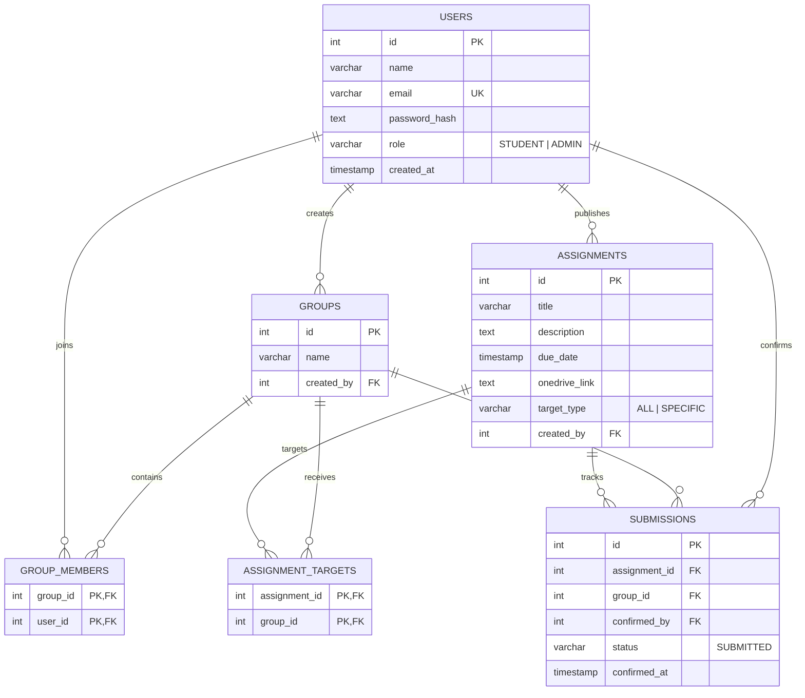

# Joineazy – Student, Group & Assignment Management System (Task 1)

A full-stack role-based academic workflow platform enabling **Professors (Admins)** to create and track assignments with OneDrive submission links, and **Students** to form groups, invite peers, and perform two-step verified assignment submissions.

- **Live Frontend (Vercel):** https://joineazy-task1-chi.vercel.app
- **Live Backend API (Render):** https://joineazy-task1-bie6.onrender.com
- **Demo Credentials:**
  - **Professor (Admin):** `prof@joineazy.com` / `123456`
  - **Student:** `student1@joineazy.com` / `123456`

---

## 1. Overview of Implementation
- **Role-Based JWT Authentication:** Supports `STUDENT` and `ADMIN` (Professor) roles with `bcryptjs` password hashing and stateless Bearer JWT tokens (`24h` expiry).
- **Student Group Management:** Students create groups, automatically become the initial member, and invite peers via student email or numeric ID.
- **Targeted Assignment Distribution:** Professors create and edit assignments with external OneDrive folder links and target either `ALL` students or `SPECIFIC` groups.
- **Two-Step Submission Confirmation:** Students access the OneDrive submission folder and confirm group-level submission once, preventing duplicate submissions via database-level unique constraints (`UNIQUE(assignment_id, group_id)`).
- **Real-Time Admin Analytics:** Professors monitor total assignments, active student groups, overall submission completion rates, and group-by-group submission status.

---

## 2. System Architecture & Data Flow
```text
┌───────────────────────────┐       HTTPS / REST JSON        ┌──────────────────────────────────┐
│   React + Tailwind CSS    │ ─────────────────────────────▶ │      Node.js + Express API       │
│    (Hosted on Vercel)     │ ◀───────────────────────────── │        (Hosted on Render)        │
└───────────────────────────┘     JWT Bearer Authorization   └──────────────────────────────────┘
                                                                              │
                                                                    SSL PostgreSQL Pool
                                                                              ▼
                                                             ┌──────────────────────────────────┐
                                                             │    Neon Serverless PostgreSQL    │
                                                             │  (Auto-initialized schema.sql)   │
                                                             └──────────────────────────────────┘

```

## 3. Database Schema & Relationships (ER Diagram)

---

    

    ## 4. API Endpoint Details

### Authentication
| Method | Endpoint | Access | Description |
| :--- | :--- | :--- | :--- |
| `POST` | `/api/auth/register` | Public | Register a new `STUDENT` or `ADMIN` user |
| `POST` | `/api/auth/login` | Public | Authenticate user and return signed JWT + profile |

### Groups (Student & Admin)
| Method | Endpoint | Access | Description |
| :--- | :--- | :--- | :--- |
| `POST` | `/api/groups` | `STUDENT` | Create a new group and enroll creator as member |
| `POST` | `/api/groups/:id/members` | `STUDENT` | Add a student to the group by email or numeric ID |
| `GET` | `/api/groups/my` | `STUDENT` | Retrieve current student's group details and member list |
| `GET` | `/api/groups` | `ADMIN` | List all registered student groups for assignment targeting |

### Assignments & Submissions
| Method | Endpoint | Access | Description |
| :--- | :--- | :--- | :--- |
| `POST` | `/api/assignments` | `ADMIN` | Publish an assignment (`ALL` or `SPECIFIC` group IDs) |
| `PUT` | `/api/assignments/:id` | `ADMIN` | Update assignment title, description, due date, or OneDrive URL |
| `GET` | `/api/assignments` | Authenticated | Fetch all assignments (Admin) or group-filtered assignments with status (Student) |
| `POST` | `/api/assignments/:id/confirm` | `STUDENT` | Confirm two-step group submission for an assignment |
| `GET` | `/api/analytics` | `ADMIN` | Fetch assignments, groups, and group-wise submission records |

### 6. Key Design & Deployment Decisions
Raw SQL over ORMs: Used the native pg driver with parameterized queries instead of a heavy ORM like Prisma or Sequelize. This kept the Express backend lightweight and allowed full control over the LEFT JOIN queries needed for the admin analytics dashboard.

Database-Level Data Integrity: Enforced a UNIQUE(assignment_id, group_id) constraint directly in PostgreSQL. This guarantees that once one student confirms a submission, duplicate submissions from other group members are automatically rejected at the database level, preventing race conditions.

Stateless Authentication: Implemented role-based access control (RBAC) using JWTs. Because the tokens are stateless, the Render backend doesn't need to manage server-side sessions, which is ideal for sleep-prone free hosting environments.

Decoupled Cloud Architecture:

Frontend (Vercel): Chosen for fast React deployments and CI/CD integration.

Backend (Render): Hosts the Dockerized Express API.

Database (Neon): Serverless PostgreSQL was selected for its built-in connection pooling, which prevents the Node API from exhausting database connections when the server wakes up from a cold start.